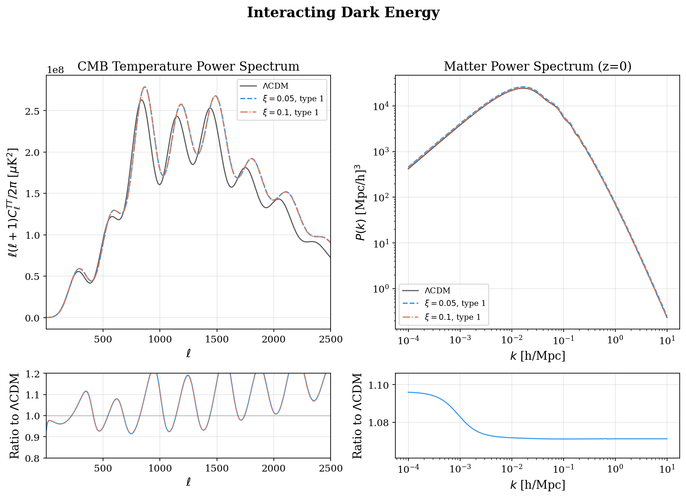
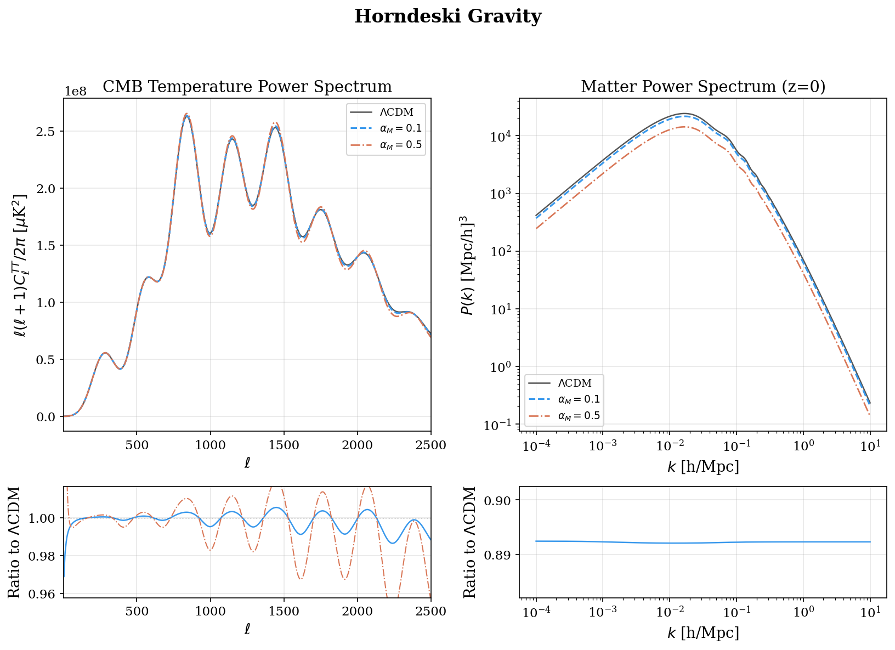
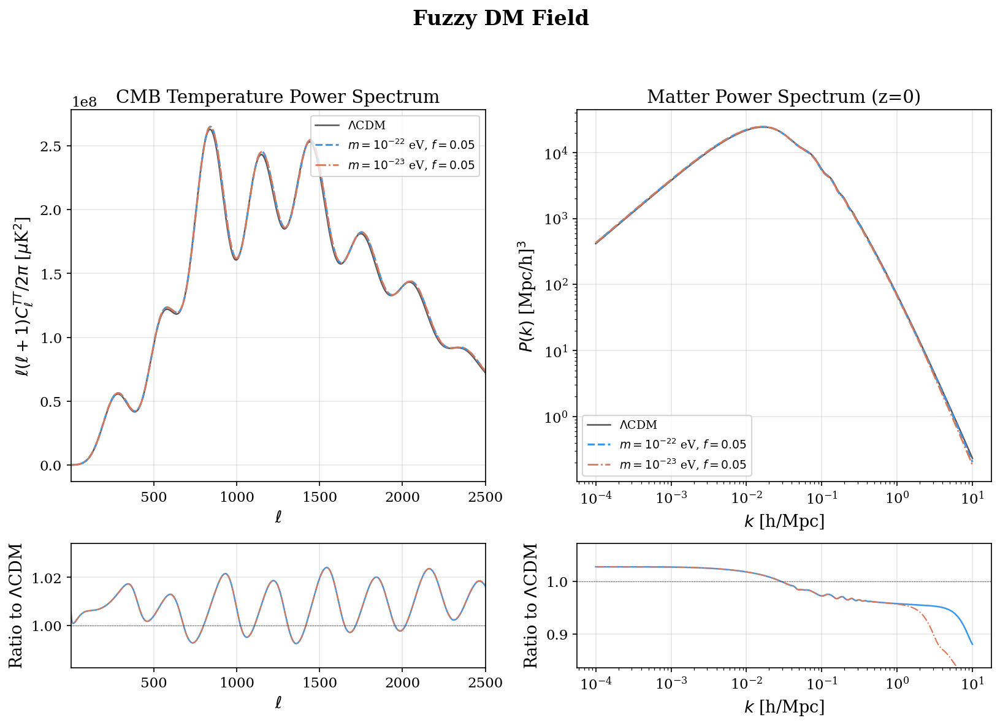

Dark Energy models
==================================

.. autoclass:: camb.dark_energy.DarkEnergyModel
   :members:

.. autoclass:: camb.dark_energy.DarkEnergyEqnOfState
   :show-inheritance:
   :members:

.. autoclass:: camb.dark_energy.DarkEnergyFluid
   :show-inheritance:
   :members:

.. autoclass:: camb.dark_energy.DarkEnergyPPF
   :show-inheritance:
   :members:

.. autoclass:: camb.dark_energy.Quintessence
   :show-inheritance:
   :members:

.. autoclass:: camb.dark_energy.EarlyQuintessence
   :show-inheritance:
   :members:

Interacting Dark Energy
-----------------------

.. autoclass:: camb.dark_energy.InteractingDE
   :show-inheritance:
   :members:

Horndeski Scalar-Tensor Gravity
-------------------------------

.. autoclass:: camb.dark_energy.HorndeskiDE
   :show-inheritance:
   :members:

Fuzzy DM Field (Klein-Gordon)
-----------------------------

.. autoclass:: camb.dark_energy.FuzzyDMField
   :show-inheritance:
   :members:

.. autoclass:: camb.dark_energy.AxionEffectiveFluid
   :show-inheritance:
   :members:

Native ini interface for interacting dark energy
-----------------------------------------------

The Fortran command-line executable can select the existing ``InteractingDE``
class directly, using the same ``ReadParams`` implementation as its parameter
interface. For example, a type-1 coupling can be specified by::

    dark_energy_model = InteractingDE
    w = -0.9
    wa = 0
    xi_ide = -0.01
    interaction_type = 1
    cs2_ide = 1

This exposes the existing model rather than changing its physical equations.
The native CLI regression checks the zero-coupling LCDM limit and finite output
at a nonzero type-1 coupling. The model's existing approximation and stability
limits still apply; this interface does not validate every parameter choice or
interaction type.

InteractingDE phantom-side zero-coupling regression
-------------------------------------------------

The IDE perturbation state stores ``(1+w)*v_de``. Recovering ``v_de`` must divide
by a signed ``1+w`` (with a magnitude floor near zero), not by ``abs(1+w)``.
The latter reverses velocity terms for constant phantom ``w<-1`` and can make
the uncoupled model fail with DVERK error -3. The native CLI regression compares
total-matter transfers against the separately implemented fluid at ``w=-1``,
``-0.9`` and ``-1.1``, all at zero coupling. This checks the uncoupled limit;
it does not certify the interacting perturbation prescription against an
independent IDE solver.
